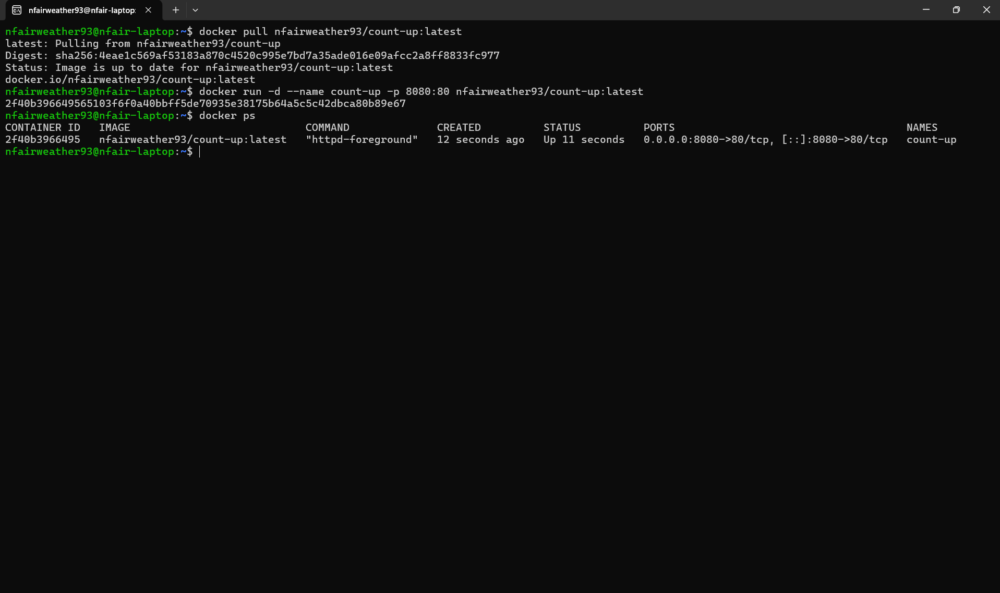
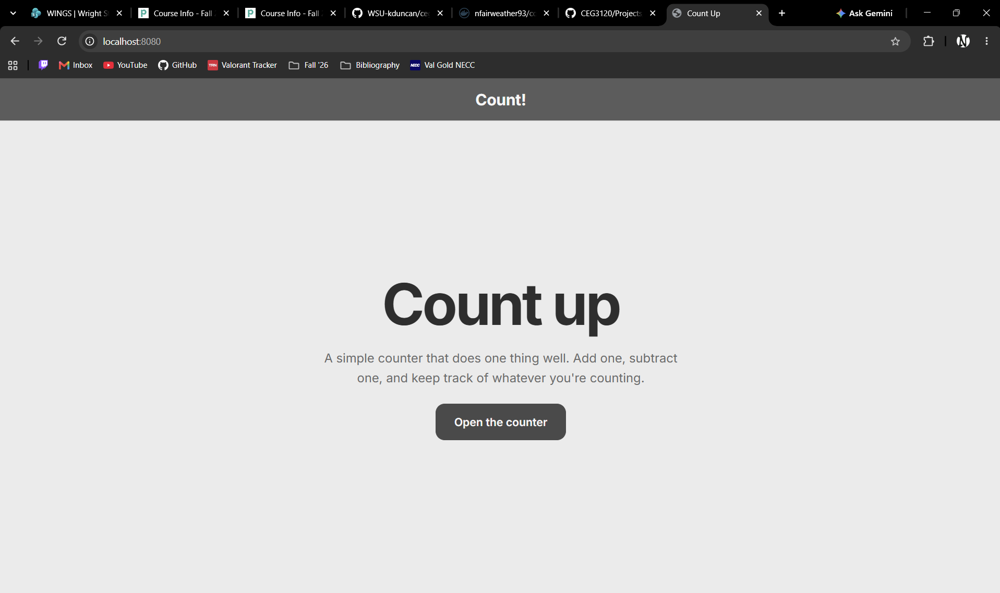
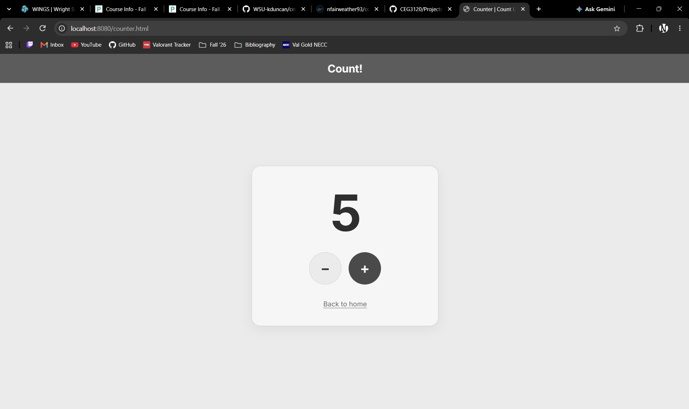
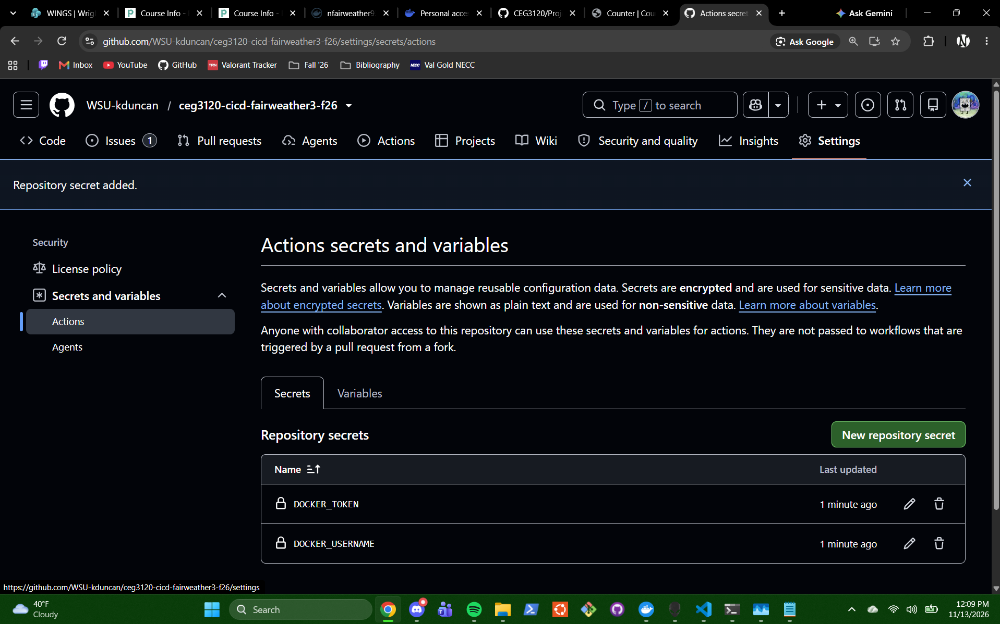

# Nathan Fairweather
---

# Part 4 - Project Description & Diagram

# Part 1 - Create a Docker container image

- The website located in [web-content](./web-content/) was "developed" using AI (Claude), as per the instructions (and is also the same one that I used in project 5). Once again, the prompt I used is as follows:
```
You are a senior full-stack developer. Create a simple website that contains the following:

- index.html, an html file representing the landing page of the website. The landing page for a cite titled "count up"
- counter.html, a second web page containing a counter in the middle of the screen, with two buttons to count a shown value up or down.
- style.css, the style for every page on the cite. The color scheme should be a simple and grayscale, but not too dark
- functionality.js, a javascript program that handles the functionality of the page, such as the counter in counter.html

The page should contain simple navigation: The homescreen can navigate to the counter, the counter can navigate back to the homescreen

Add a title bar to the page that stays consistent across both html scripts. It should have the title "Count!"

Lastly, please make the website appear modern. Make sure text sizing looks good and give me all of the scripts listed with their given parameters.
```

### DockerHub Repository for the Website
---
`https://hub.docker.com/repository/docker/nfairweather93/count-up/general`

## Docker Image and Website running on LocalHost (LocalRun Screenshots)

**`docker ps` running the docker image provided at my repository listed above.**


**Both HTML webpages running on `localhost:8080`** 



### Purpose of web-content items
---
- [index.html](./web-content/index.html) is the landing page of the website, with a simple button to move the page to [counter.html](./web-content/counter.html)
- [counter.html](./web-content/counter.html) is the second page of the site. It has a number in the middle that can be incremented up or down, one at a time. Also, there is a label to move back to the home screen.
- [functionality.js](./web-content/functionality.js) is a javascript file used to control the buttons in counter.html so that they actually increment the number on the page.
- [style.css](./web-content/style.css) is the style for both of the html pages (colors, fonts, margins, etc...)
- [Dockerfile](./web-content/Dockerfile) helps build the Docker Image. It serves two purposes:
    - `FROM httpd:2.4` to start the apache web server image
    - `COPY . /usr/local/apache2/htdocs/` to take everything in the current folder (which should be web-content) and put it in Apache's root inside of the created image, which should make those files run (clearly bc I can see it running).

### How to get it running
---
The Docker Image is stored in this repository:
`https://hub.docker.com/repository/docker/nfairweather93/count-up/general`

With that, starting it was really easy.
- Pull the image:
    - `docker pull nfairweather93/count-up:latest`
- Start the image:
    - `docker run -d --name count-up -p 8080:80 nfairweather93/count-up:latest`
- Verify it is running:
    - `docker ps`
- Check for the site on the correct port:
    - http://localhost:8080

# Part 2 - GitHub Actions and DockerHub

### Creating a PAT for Authentication
1. **GitHub Repo Secrets**
- DockerHub -> Account Settings -> Personal Access Tokens -> Generate New Token
    - Give a description (CS3120-Project6)
    - I'm setting it to never expire
    - Permissions = R/W
    - Generate
- GitHub Repo -> Settings -> Secrets and Variables -> Actions -> New Repository Secret
    - Secret 1: `DOCKER_USERNAME`
    - Secret 2: `DOCKER_TOKEN`

---

**The repository secrets page with DOCKER_USERNAME and DOCKER_TOKEN.**

The repo secrets are `DOCKER_USERNAME` and `DOCKER_TOKEN`. The first of those values is just my docker username, not much of a secret, the other one is the PAT that was created right before this, and then pasted into DOCKER_TOKEN as its value.


---
2. **GitHub Actions Stuff** *(Really useful links to sources to help make this)*
    - `https://www.telerik.com/blogs/introduction-github-actions`
    - `https://docs.github.com/en/actions/tutorials/use-containerized-services/create-a-docker-container-action`
    - `https://docs.docker.com/build/ci/github-actions/`

[docker-publish.yml](/.github/workflows/docker-publish.yml) creates a GitHub actions workflow to build my website's docker image and push it to DockerHub.

---

### Workflow Trigger
```yaml
on:
  push:
    branches:
      - main
```
The workflow should only run when a commit is pushed to `main`. Pushes to other branches should not trigger it because of this.

---

### Workflow Steps
The workflow should run only one job (`build-push-jobs`) on `ubuntu-latest`. I believe each step should be running with an action as they should from a publisher (like *actions/* or *docker/*) instead of using a shell command.

| Actual Step          | Command                         | Purpose |
| ---------------------| ------------------------------- | ------- |
| Checkout Repo        | `actions/checkout@v6`           | Clone the repo onto ubuntu-latest so that the Dockerfile and website can build|
| DockerHub Login      | `docker/login-action@v4`        | Use repo secrets (`DOCKER_USERNAME` + `DOCKER_TOKEN`) to authenticate to DockerHub |
| Set up Docker Buildx | `docker/setup-buildx-action@v4` | Set up Buildx, which docker can use to build the image |
| Build / PUsh Image   | `docker/build-push-action@v7`   | Builds the image from the Dockerfile (`context: .`) and pushes it to DockerHub (with two tags set) |

- **Tags added to each run:**
    - `nfairweather93/count-up:latest`: most recent build from `main`. Should be the default from `docker pull ...`
    - `nfairweather93/count-up:(sha)`: permanent tag named after the commit SHA. Should let every image be pointed back to the commit that built it.

---
## If this is reused in a different repo
*If a different repository is used*:

### Changes in workflow file
| Value | Current Value | Change it to |
|---|---|---|
| `branches:` | `main` | The name of whatever default branch a different repo may have (like *master*, for instance) |
| Image name in `tags:` | `count-up`| If pushing to a different repo, change the name of the DockerHub repo in tags |
|`context:` | `.` (which should be the web-content folder) | Change to wherever the Dockerfile and website files are located |
| Versions | `@v6`, `@v4`, `@v4`, `@v7` | Check marketplace pages for newer release versions |

### Changes in Repo
- New Repository Secrets would need created.
    - `DOCKER_USERNAME` would need set to the DockerHub username that owns the target repo
    - `DOCKER_TOKEN` would need set to a PAT with R/W permissions.

---

Documentation Stuffs

- Link to the Part 2 version of workflow file, using a commit permalink (file on `main` will change later)

3. Testing & Validation
    - How to test that the workflow did its tasking
    - How to verify that the image in DockerHub works when a container is run using the image
    - Link to DockerHub Repo

# Part 3 - Semantic Versioning

# Extra stuff that needs to be in here so I don't forget it and don't know where it goes yet

## Images
- [ ] Main Trigger - A successful workflow run from a push to `main`, with the commit SHA visible.
- [ ] Branch Negative Test - Push a commit to a branch other than `main`, and show the commit on that branch and that no workflow run started
- [ ] Change to image - change visible text on your site and push it to `main`. After the workflow succeeds, pull and run the new image and show the change in a browser.
- [ ] Tag trigger - `git tag -l` output, and a successful workflow run with a tag as its event.
- [ ] Tag negative test - push a commit without a tag, and show the commit and that no workflow run started.
- [ ] Tag set - your DockerHub repo's tags showing `latest`, `major`, and `major.minor`.
- [ ] Two Releases - After your second release, your DockerHub tags and digests showing that 1 and latest moved to the new image while 1.0 stayed on the old image.
- [ ] Rollback - run containers from your `major.minor` tags and show in a browser that each server its version of the site.